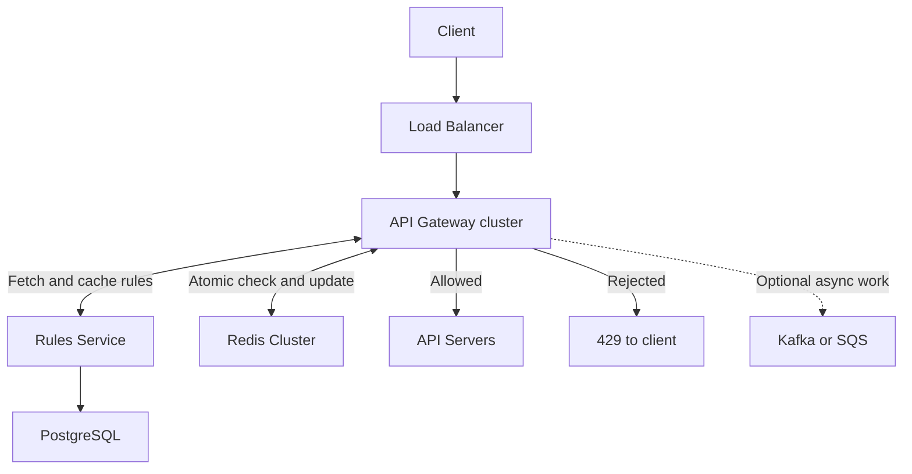

# API Rate Limiter

An API rate limiter is a control mechanism that restricts the number of requests a client (user, application, or IP address) can make to an Application Programming Interface (API) within a specific timeframe

## 1. Problem Clarification and Requirements

### Clarification questions asked by the candidate

1. Are we limiting requests on the client side or server side?
- Client-side rate limiting is only an additional UX optimization to reduce unnecessary requests. Example: a client-side limiter may disable the “Send OTP” button for 30 seconds. But an attacker can call the OTP API directly using Postman or a script. Therefore the server must still enforce: “maximum 3 OTPs per phone number per hour.”
- Server side rate limiter is preferred for actual protection as it cannot be by-passed by user preventing abuse, DDoS, cost spikes, overload. It is usually at the API Gateway using Redis and Token Bucket/Sliding Window.
- Best real-world approach: both—client side for smooth UX, server side for actual protection.

2. Is this one service or a distributed system? Should the limiter sit at the API Gateway?
- For one service, a local in-process rate limiter can be used to handle traffic.
- For distributed system, use a shared limiter which is usually a Redis with atomic operations. Hence, all instances consult shared state and client cannot bypass the limit by landing on different server.
- For public APIs, the main limiter can be setup at API gateway. It rejects excess traffic before it consumes application, database, or downstream-service resources. 

3. Should limits apply per user, IP, API key, endpoint, or a combination?
- Use IP-based limits for anonymous abuse protection
- user/API-key limits for autheticated users for fair usage and quotas
- endpoint-specific limits for costly or sensitive APIs

4. Do different plans have different limits? Are short bursts allowed?
- Allowing different limits provide mulitple tier support which can be fetched using rules service
- short bursts allows user to consume its limit immediately as per its will by triggering several API calls at once. But this makes real traffic is uneven. Hence, algorithms like token-bucket rate limiting is commonly used when short bursts should be allowed.

5. What traffic volume and added latency should we support?
- The rate limiter should not have higher latency as it could become a bottleneck. Ex: Allowing less than 10ms p99 latency is fine, i.e. maximum add 10 milliseconds of delay for 99% of requests as these are acceptable figures.

6. Should excess requests return 429 or be queued?
- 429 requests can be directly retured to user when quota is exceeded but if Queuing is allowed, then these request needs to be stored at some Message Queuing system to process later.

7. Are limits regional or global? What should happen if the limiter fails?
- If user has global limits i.e., the same user gets only specific amount of RPS worldwide which is stricter and more accurate but this add cross-region coordination which adds more latency and complexity to the system. Hence, regional limits are more practical
- Failure can be handled using two fallbacks policies: Fail Open (allow requests even if limiter is unavailable), Fail Closed (reject requests when limiter is unavailable). A practical choice is usually fail open with safe local limits: gateways use a cached rule and a smaller per-instance allowance until Redis recovers.

**Clarified problem statement:** Design a server-side, distributed rate limiter at the API Gateway. Identify authenticated clients by user ID or API key, and guests by IP. Support configurable plan limits and endpoint overrides. Return HTTP 429 when a quota is exceeded, add less than 10 ms p99 latency, and use safe local limits during Redis outages. Regional enforcement is sufficient; approximate rolling-window limits are acceptable.

### Functional requirements — what it does

- **Identify User:** limit by user, API key, or IP, together with the endpoint group.
- **Configure Rules:** free 100/min, paid 1,000/min, enterprise 10,000/min; allow stricter endpoint rules.
- **Track/Allow/Reject Requests:** maintain each user’s request count within the configured time window. Also, allow requests within the quota; reject excess requests.
- **Return Response:** send HTTP 429 Too Many Requests with Retry-After when a limit is exceeded.
- **Regional Enforcement:** apply limits independently in each region.
- **Handle Failures:** use safe local fallback limits when Redis is unavailable (It means each API Gateway instance temporarily rate-limits requests using its own memory when Redis/shared rate-limit storage is unavailable)

### Non-functional requirements — how well it works

- **Fast:** less than 10 ms p99 added latency.
- **Available:** target 99.99%; use a fallback during dependency failures.
- **Scalable:** handle the estimated 350K peak RPS and grow horizontally by adding gateway/Redis instances.
- **Consistent enough:** atomic shared decisions; approximate rolling counts and short rule-update delays are acceptable.

## 2. Traffic Estimation / Back-of-the-Envelope Estimation

Assume **100M daily active users**, **100 calls/user/day**, and a **3× peak factor**.

| Estimate | Calculation | Result |
| --- | --- | --- |
| Daily requests | 100M × 100 | 10 billion |
| Average RPS | 10B ÷ 86,400 | ~116K |
| Peak RPS | 116K × 3 | ~350K |
| Redis calls | One atomic script/request | ~350K calls/sec at peak |
| Redis bandwidth | Assume 200 bytes combined per call × 350K | ~70 MB/sec, excluding overhead |

**Memory:** size by active **identity + endpoint** pairs, not just daily users. If 100M pairs each take an assumed 200 bytes, that is **~20 GB primary state**. One replica doubles it to ~40 GB; add headroom. Measure actual Redis overhead and active pair count.

**Capacity starting point:** 10 primary shards would average ~35K script calls/sec each. Benchmark the actual script before promising throughput or latency. Replicas provide availability; shards distribute write load.

> **Interviewer:** Why are you estimating traffic before choosing databases?
>
> **Candidate:** Traffic tells us how much shared state, throughput, and network capacity the design needs. Here, hundreds of thousands of checks per second suggest an in-memory shared store.

## 3. Define Core Data Models and APIs

### Core models

| Model | Essential fields |
| --- | --- |
| Client | Identity, identity type, tier |
| Rule | Tier, endpoint group, algorithm, limit, window |
| Sliding-window state | Window ID, current count, previous count |
| Decision | Allowed, remaining quota, retry delay |

**Example rule:** `free + orders_read → 100 requests / 60 seconds`.

**Redis state:**

```text
Key:   rate_limit:{user_123}:orders_read
Value: {window_id, current_count, previous_count}
TTL:   120 seconds for a 60-second sliding window
```

Use an endpoint group such as `orders_read`, rather than a different key for every order URL. User identity stays the same across devices and plan changes.

**Storage choice:**

- **Redis:** fast, shared, temporary limiter state; supports atomic scripts and expiry.
- **PostgreSQL:** durable, structured rules; low write volume and validated updates.

### Core APIs

| API / function | Purpose |
| --- | --- |
| `checkAndConsume(identity, tier, endpointGroup)` | Internal gateway function → allowed, remaining, retry delay |
| `GET /internal/rate-limit-rules` | Fetch rules from the Rules Service |
| `PUT /admin/rate-limit-rules/{id}` | Authorized rule update |
| `GET /api/orders` | Example protected business API |

The limiter function runs **inside the gateway**; it does not need a separate HTTP service.

**Rejection response:** `HTTP 429 Too Many Requests`, with `Retry-After` and optional custom `X-RateLimit-Limit` / `X-RateLimit-Remaining` headers. Calculate retry delay using the selected algorithm.

> **Interviewer:** Why not keep the counters in PostgreSQL too?
>
> **Candidate:** PostgreSQL fits durable rule configuration. The request path needs frequent, low-latency shared updates, so Redis fits the counters better. Gateways cache rules to avoid a database call per request.

## 4. High-Level Design and Component Details

### 4.1 Build the design from the base diagram

Start with **Client → Load Balancer → API Gateway → API Servers**. Add the **Rules Service** for configuration and **Redis** for shared limiter state. At the gateway, branch into **allowed**, **429**, or the **optional asynchronous queue**.



| Component | What it does |
| --- | --- |
| Load Balancer | Sends traffic to healthy gateways |
| API Gateway | Authenticates, routes, applies rules, and enforces limits |
| Rules Service | Manages rules and distributes updates |
| Redis Cluster | Holds shared state and returns an atomic decision |
| API Servers | Process admitted requests and return responses |
| Optional queue | Holds supported asynchronous work for later processing |

### 4.2 Complete request flow — match the diagram's steps

1. **Request:** client sends an API request; the Load Balancer forwards it to a gateway.
2. **Rules:** gateway identifies the client and endpoint group, then checks its local rule cache. Fetch rules from the Rules Service on startup or a cache miss.
3. **Cache:** Rules Service returns the applicable rules; gateway caches them.
4. **Check and update:** gateway builds the Redis key and runs one atomic script to calculate usage and consume quota if allowed.
5. **Decision:** Redis returns allowed/denied, remaining quota, and retry information.
6. **Result:** if allowed, gateway forwards to an API Server and returns its response. If denied, gateway returns 429 immediately; the API Server is never called.

**Identity:** validate JWT/API-key credentials; use trusted client IP for guests. Trust forwarded IP headers only from known proxies.

**Why the gateway?** It protects backends early and applies one policy across services, without an extra limiter-service hop.

### 4.3 Algorithm — Sliding Window Counter

Use **Sliding Window Counter** for the approximate per-minute quotas in this design: low memory with smoother boundaries than Fixed Window.

```text
previous_weight = 1 − elapsed_in_current_window / window_size
estimated_usage = current_count + previous_count × previous_weight
Allow when estimated_usage + 1 ≤ limit.
```

**Example:** limit = 100/min. Halfway through the minute, current count = 40 and previous count = 80:

```text
Usage = 40 + 80 × 0.5 = 80
Next request makes it 81 → allow.
```

Keep current/previous counts and a window ID. Retain state for two windows; expired idle state starts empty. This is an approximation, not an exact rolling-window guarantee.

| Algorithm | Remember it as |
| --- | --- |
| Fixed Window | Simple, but allows boundary bursts |
| Sliding Window Log | Exact, but stores request timestamps |
| Sliding Window Counter | Low memory, approximate rolling usage — chosen here |
| Token Bucket | Steady refill with controlled bursts |
| Leaky Bucket | Smooth outgoing work; queued form adds delay |

> **Interviewer:** The diagram also shows Token Bucket. When would you use it?
>
> **Candidate:** When controlled bursts are part of the requirement. The diagram's example has **100-token capacity**, **10 tokens/sec refill**, and **1 token/request**. It permits a burst of 100 and sustains 10 requests/sec. For an average of 100/min with bursts of 200, use capacity 200 and refill 100/60 tokens/sec. Store tokens and last refill time in Redis.

### 4.4 Prevent race conditions

Perform **read → calculate → decide → update → set expiry** inside one Redis Lua script. Use server time for the calculation.

> **Interviewer:** Two gateways see usage near 99 against a limit of 100. Could both allow a request?
>
> **Candidate:** The complete scripts execute serially on the same Redis primary. At effectively the same time, the first consumes the last available unit and the second rejects. Separate client-side reads and writes would create a race.

`INCR + EXPIRE` alone describes a fixed-window implementation; a sliding counter must also account for the previous window.

### 4.5 Cache rules and partition state

- **Local rules cache:** refresh every 60 seconds; optional change notifications speed up updates. Keep the last valid rules during a brief Rules Service outage.
- **Shared Redis state:** every gateway uses the same state for an identity/endpoint pair. Expiry removes idle state.
- **Partitioning:** Redis Cluster distributes identities across shards. A single very busy identity can still create a hot key.

> **Interviewer:** Why not store all counters inside each gateway?
>
> **Candidate:** Requests can land on different gateways. If each pod gets the full quota independently, the user can receive roughly N times the intended limit across N pods. Shared Redis state avoids that during normal operation.

### 4.6 Optional queue

Keep **429 as the default**. Use Kafka/SQS only when the API supports delayed jobs: return **202 + job ID**, then let workers process the job. Bound the queue and use idempotency to avoid duplicate work. Do not return 429 and silently execute that request later.

## 5. Address Scale, Failures, and Trade-offs

| Concern | Simple approach | Trade-off |
| --- | --- | --- |
| More traffic | Add gateway instances and Redis shards | More operational cost; sharding does not fix one hot key |
| Redis node failure | Replicas across availability zones and cluster failover | Some recent counts may be lost |
| Redis unavailable | Short timeout, circuit breaker, safe local limits | Local fallback cannot enforce an exact shared quota |
| Rules Service unavailable | Use cached, last valid rules | Rule updates are delayed |
| Abusive traffic | Edge/IP filtering before expensive work | Coarse IP limits can affect shared networks |
| Multiple regions | Regional limiter state | Per-region quotas can exceed one global quota |

**Failure policy:** safe local fallback follows the base diagram. Choose **fail-open** when availability matters most, or **fail-closed** for stricter routes. Dependency failure is not proof of a quota violation; a fail-closed dependency response can be 503.

> **Interviewer:** What if we need a strict global quota?
>
> **Candidate:** Independent regional quotas are insufficient. Split a global budget across regions or coordinate through an authority, accepting additional complexity and possible latency or reduced utilization.

**Monitor:** rejection rate, limiter p99 latency, Redis errors/memory, fallback usage, and rule-update failures. Operational work mainly involves rule management, capacity planning, and failover testing.

## Summary

Enforce limits at the **API Gateway**, use a **Sliding Window Counter in Redis**, and manage rules through a **PostgreSQL-backed Rules Service with local caching**. Atomic checks prevent decision races; rejected requests return **429 + Retry-After**. Scale gateways and Redis horizontally, use safe local fallback during outages, and keep queuing optional for asynchronous APIs.

**Recall order:** Clarify → Requirements → Estimate → Models/APIs → Request flow → Algorithm → Scale/failures → Summarize.

